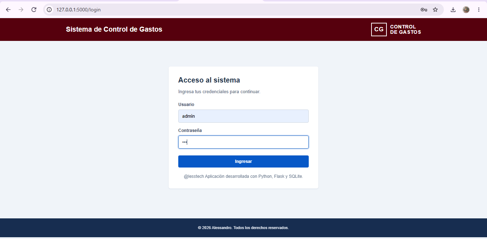
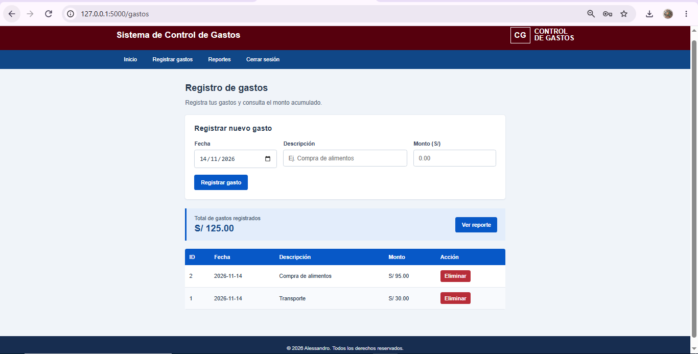
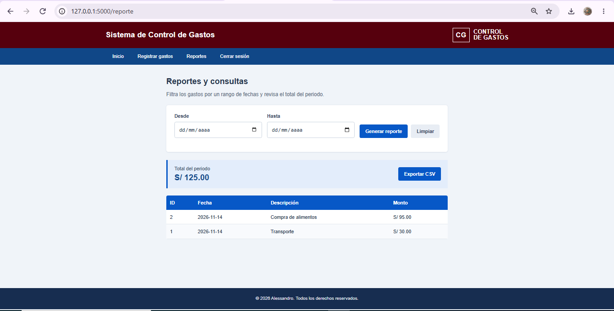

# UNIVERSIDAD PRIVADA DE TRUJILLO

CARRERA:
INGENIERÍA DE SISTEMAS E INTELIGENCIA ARTIFICIAL
# SEMESTRE:
VII
# TEMA:
DISEÑO Y SIMULACIÓN DE AUTÓMATAS UTILIZANDO JFLAP
# CURSO:
LENGUAJE, PENSAMIENTO Y COGNICIÓN VISUAL
# DOCENTE:
Dr. DIAZ PULIDO, José Arturo
# ESTUDIANTE: 
LUQUE QUISPE, Alessandro Anthony

# Sistema de Control de Gastos

Aplicación web para registrar gastos personales y generar reportes por rango de fechas. Está desarrollada con **Python, Flask, SQLite, HTML y CSS**.
## Capturas

### Acceso al sistema

### Registro de gastos

### Reporte por fechas

## Credenciales de acceso

- **Usuario:** `admin`
- **Contraseña:** `123`

> Son credenciales de demostración solicitadas para este proyecto.

## Funcionalidades

- Inicio de sesión y cierre de sesión.
- Registro de gastos con fecha, descripción y monto en soles.
- Listado de gastos registrados y suma acumulada.
- Eliminación de registros.
- Reporte filtrado por fecha inicial y final.
- Exportación del reporte a archivo CSV.
- Base de datos SQLite.

## ¿Cómo funciona?

1. **Acceso:** el usuario ingresa sus credenciales.
2. **Registrar gasto:** completa fecha, descripción y monto; presiona “Registrar gasto”.
3. **Consultar:** la tabla muestra los registros y el total acumulado.
4. **Generar reporte:** ingresa las fechas “Desde” y “Hasta” y presiona “Generar reporte”.
5. **Exportar:** presiona “Exportar CSV” para descargar el detalle del periodo en una hoja de cálculo.
6. **Cerrar sesión:** utiliza la opción del menú superior.

